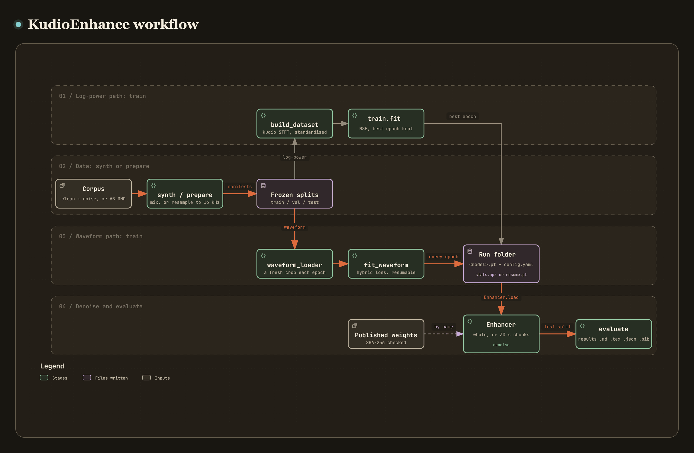

# KudioEnhance

**English** | [繁體中文](https://github.com/recklight/KudioEnhance/blob/master/README.zh-TW.md)

[](https://pypi.org/project/kudioenhance/)
[](https://www.python.org/)
[](https://pytorch.org/)
[](https://github.com/recklight/KudioEnhance/blob/master/LICENSE.txt)
[](https://pypi.org/project/kudio/)

**Train and run learned speech-enhancement (denoising) models**, built on the
[`kudio`](https://pypi.org/project/kudio/) audio toolkit, or denoise with the
weights trained here.

Three stages, one config file:

[](https://raw.githack.com/recklight/KudioEnhance/master/docs/workflow.html?theme=dark)

The figure is a link to an interactive version — [open it online](https://raw.githack.com/recklight/KudioEnhance/master/docs/workflow.html?theme=dark), or open `docs/workflow.html` from a checkout. You can zoom, search for a node, or trace the path between two of them, and most boxes carry a link to the lines of source they were drawn from, at the commit they were checked against.

Each stage reads what the one before it wrote, so you can re-train without
re-mixing and re-evaluate without re-training. `run` does all three in order.

There are two paths through them. Five models work in the **log-power
spectrogram domain** and reuse the noisy phase — the standard magnitude-only
enhancement setup. Feature extraction and reconstruction both go through
`kudio`, so what the model sees is exactly what any other kudio-based tool
produces. The sixth, `gtcrn`, reads the **complex spectrum**, puts out a
complex mask and learns from waveforms. It has 23,669 weights, few enough to
train on a CPU, and its weights trained on VoiceBank-DEMAND are published
([Pretrained weights](#pretrained-weights)). [The two paths](#the-two-paths)
sets them side by side, and
[Results on VoiceBank-DEMAND](#results-on-voicebank-demand) scores both.

## Install

```bash
pip install kudioenhance
```

The command is `kudioenhance` and the package `import kudioenhance`.

Needs **Python 3.9+** and **PyTorch ≥ 2.4.1**. The models are plain
`torch.nn` modules, trained by a loop in this package — no Keras, no
Lightning. Older torch wheels, and 2.4.0's on Windows, were built against
NumPy 1, which nothing stops pip from installing beside NumPy 2, and there
they fail at the first `torch.from_numpy`.

On Linux the default `torch` wheel bundles CUDA and runs to several
gigabytes. Without an NVIDIA GPU, install the CPU-only build **first** and pip
will keep it when it installs this package:

```bash
pip install torch --index-url https://download.pytorch.org/whl/cpu
pip install kudioenhance
```

The Windows and macOS wheels on PyPI carry no CUDA, so they stay small.
Training takes an NVIDIA GPU whenever torch can see one (`device: auto` in the
`train` section), so the same config works on both kinds of machine. Apple's
GPUs are not used: torch can drive them through `mps`, but this package does
not ask it to, and on a Mac training runs on the CPU.

STOI and SDR are optional: `pip install "kudioenhance[eval]"`. **PESQ is a
separate extra**, `pip install "kudio[pesq]"`, because it builds from source
— a C compiler, and the MSVC Build Tools on Windows — so it is deliberately
left out of `[eval]` and `[all]`, which would otherwise stop installing.

PESQ comes on two scales. `evaluate` reports MOS-LQO by default; pass
`--pesq-scale raw` for the narrowband P.862 score before the P.862.1 mapping.
They are different scales, not different roundings: raw 2.03 is about
1.66 MOS-LQO. Papers quote both, so check which one a paper used before
setting your numbers beside it.

## Pretrained weights

To denoise without training anything:

```bash
kudioenhance pretrained                          # what is published, what is cached
kudioenhance denoise gtcrn-vbd16k noisy.wav enhanced.wav
kudioenhance denoise gtcrn-vbd16k noisy/ clean/ --recursive
```

| Name | Model | Trained on | WB-PESQ | Licence | |
|---|---|---|---|---|---|
| `gtcrn-vbd16k` | `gtcrn`, 23,669 weights, 16 kHz, causal | VoiceBank-DEMAND, 26 speakers, on the CPU | 2.77 on its test set | CC BY 4.0 | [model card](https://github.com/recklight/KudioEnhance/blob/master/docs/models/gtcrn-vbd16k.md) |

The first use downloads the file into the cache, `~/.cache/kudioenhance`
(`$KUDIOENHANCE_CACHE` or `$XDG_CACHE_HOME` to move it, or `--cache DIR` on
both commands), and `kudioenhance pretrained gtcrn-vbd16k` downloads it
ahead of time, for a machine that will be offline. The file is the `.pt` its training run wrote,
unchanged, and its SHA-256 is part of the release: a download is checked
before it is kept, and the cached file again every time it is loaded, so a
file that changed on disk is fetched anew rather than used. Wherever a run
directory goes, in `denoise` and in `Enhancer.load`, the name goes too; a
folder of that name wins. In Python:

```python
from kudioenhance import Enhancer

enh = Enhancer.pretrained("gtcrn-vbd16k")
enh.enhance_file("noisy.wav", "enhanced.wav")
```

Only waveform-path weights are published. A log-power model needs its run's
normalisation statistics too, and an entry is one file. The weights are
under CC BY 4.0, like the data they were trained on, which asks to be
credited; the model card has the training run, the scores with kudio's
signature, and what to cite.

## Quick start

```bash
kudioenhance init config.yaml        # starter config
kudioenhance run -c config.yaml -n exp1
```

That mixes the dataset, trains, and prints the before/after scores:

```
si_sdr      -4.812 ->    6.933  (+11.745)
snr         -4.998 ->    5.221  (+10.219)
seg_snr     -6.114 ->    1.870  (+7.984)
report -> runs/exp1/report.csv
table  -> runs/exp1/results.md (.tex, .json, .bib beside it)
```

Then denoise anything with the trained run:

```bash
kudioenhance denoise runs/exp1 noisy.wav enhanced.wav
kudioenhance denoise runs/exp1 noisy/ clean/ --recursive --report
```

The folder form loads the model **once** for the whole tree, mirrors the input's
directory structure, and with `--report` says how far the noise floor moved.

And afterwards, whether it actually learned anything:

```bash
kudioenhance curves -c config.yaml -n exp1
```

```
3 epoch(s), monitoring val_loss
  best   0.12172 at epoch 3
  first  0.28104   last 0.12172
```

A training loop hands back its curves and almost every script drops them,
which makes "did it converge, or stop early because validation was already
climbing?" unanswerable the moment the terminal closes. They are written to
`runs/exp1/history.json` (and `history.png` when matplotlib is around). If the
best epoch was the *first* one the command says so and exits non-zero — that is
what "this did not learn" looks like.

### Stage by stage

```bash
kudioenhance synth    -c config.yaml -n exp1   # mix + freeze the splits
kudioenhance train    -c config.yaml -n exp1   # fit (--epochs 1 to smoke-test)
kudioenhance evaluate -c config.yaml -n exp1   # score (--full adds PESQ, STOI, ...)
```

Each stage reads what the previous one wrote, so you can re-train without
re-mixing, or re-evaluate without re-training.

### What `evaluate` writes

`evaluate` enhances every file of the test split into `runs/exp1/enhanced/`,
in 32-bit float so that what gets scored is what the model put out, and hands
the three sides to `kudio.score_dataset`: the enhanced files against the clean
ones, with the noisy files as the baseline. Beside `report.csv` the run gets
the table as `results.md`, `results.tex` and `results.json`, and
`results.bib` with the BibTeX for kudio and every metric in it. A row of the
table is the noisy input's mean, the enhanced mean, and the difference, each
with its 95% BCa interval, then the two-sided sign-flip test of the
difference and its p-value after Holm's adjustment over the rows. The
signature under the table records kudio's version, the rate, each metric's
settings and the versions of the packages behind them, so a number can be
traced back to how it was computed.

Without `--full` it scores segmental SNR, SI-SDR and SNR, which need nothing
but numpy. `--full` adds PESQ, CSIG/CBAK/COVL, STOI and SDR, and leaves out,
with a warning, whatever is not installed. `--metrics pesq,stoi,si_sdr` takes
kudio's names and scores exactly those. `--dnsmos-dir` adds DNSMOS P.835 and
P.808; that needs `pip install "kudio[dnsmos]"` and the ONNX models from
[microsoft/DNS-Challenge](https://github.com/microsoft/DNS-Challenge), which
kudio does not ship. `--jobs 4` scores four files at a time.

The sentences of one speaker are not independent, so where the file names
give the speaker, as VCTK's `p232_001.wav` does, the intervals resample whole
speakers. That needs enough speakers: under 10 an interval falls well short
of 95%, and over 2 it held the true mean half the time in kudio's
simulation. VoiceBank-DEMAND's test set has 2, p232 and p257, so there the
intervals resample sentences, and the line under the table says so: they
cover other sentences from those two speakers, not a third one. `--speakers`
takes a regular expression whose first group is the speaker, or `''` for
none.

## Results on VoiceBank-DEMAND

The 824 test utterances at 16 kHz, prepared by `kudioenhance prepare` and
scored by `kudioenhance evaluate --full --dnsmos-dir ...` through kudio
4.0.0. Each checkpoint was chosen on two training speakers held out for
validation, never on the test set, and everything was trained on one CPU, an
Intel Core i5-13600K, without a GPU.

| | Weights | WB-PESQ | CSIG | CBAK | COVL | SSNR | STOI | SI-SDR | DNSMOS OVRL |
|---|---|---|---|---|---|---|---|---|---|
| Noisy | – | 1.97 | 3.33 | 2.44 | 2.62 | 1.68 | 0.921 | 8.45 | 2.70 |
| `unet`, `irm` | 483K | 2.65 [2.61, 2.70] | 4.03 | 3.26 | 3.35 | 8.19 | 0.940 | 17.23 | 3.07 |
| `crn`, `irm` | 5.51M | 2.70 [2.66, 2.75] | 4.14 | 3.28 | 3.44 | 7.98 | 0.941 | 16.69 | 3.06 |
| `gtcrn` (`gtcrn-vbd16k`) | 23,669 | **2.77** [2.73, 2.81] | 4.09 | 3.41 | 3.43 | 9.85 | 0.939 | 18.69 | 3.07 |

- The brackets are 95% BCa intervals over sentences; the run's own
  `results.md` has one for every cell, and the
  [model card](https://github.com/recklight/KudioEnhance/blob/master/docs/models/gtcrn-vbd16k.md)
  prints `gtcrn`'s whole table with kudio's signature. In those tables
  every difference from the noisy input is significant after Holm's
  adjustment, except `gtcrn`'s DNSMOS SIG.
- SSNR is the segmental SNR of Loizou's `composite.m`,
  `kudio.composite(...).segsnr`, the column papers on this test set print.
  `evaluate`'s segSNR row is kudio's `segsnr`, which frames differently and
  gives 1.56 for the noisy files.
- The noisy row is the published one, 1.97, 2.44, 1.68, 0.921 and 8.45,
  with CSIG and COVL about 0.01 lower. The 16 kHz files here are 32-bit
  float; CMGAN's per-file logs of that row match 16-bit files with dither,
  whose noise floor moves CSIG and COVL in near-silent frames.
- `unet` and `crn` are on the log-power path with the `irm` target, at
  `n_fft: 512`, `hop_length: 256`, 64-frame windows, batch 16 and up to 40
  epochs with patience 8, streamed. They trained side by side on 4 threads
  each: `crn` stopped after 24 epochs (best 16) in 10.5 h, `unet` ran all
  40 (best 39, still improving) in 16.3 h.
- `gtcrn` trained with the settings in
  [The waveform path](#the-waveform-path-gtcrn) on 2 threads: it stopped
  after 61 epochs (best 51) in 14 h 45 min.

Published results on the same test set for light models, as the GTCRN paper
and its repository print them:

| | Weights | WB-PESQ | STOI | SI-SNR |
|---|---|---|---|---|
| RNNoise | 0.06M | 2.29 | | |
| PercepNet | 8.00M | 2.73 | | |
| DeepFilterNet | 1.80M | 2.81 | | |
| S-DCCRN | 2.34M | 2.84 | | |
| GTCRN | 23.7K | 2.87 | 0.940 | 18.83 |

The trained `gtcrn` comes within 0.001 of the paper's STOI and 0.14 dB of
its SI-SNR, but 0.10 short of its WB-PESQ, which is outside the interval.
The paper gives no crop length or epoch count for this dataset; these
weights saw 2 s crops and stopped at epoch 61, and the GTCRN author has
suggested crops of about 8 s and 200 epochs elsewhere. Whether that closes
the gap has not been tried. The GTCRN repository lists 48.2K weights; that
count includes the two fixed ERB matrices, which here are buffers. Larger
models go further: CMGAN reaches 3.41, and MP-SENet, with 2.05M weights,
3.50.

To repeat a row, prepare the corpus as in [VoiceBank-DEMAND](#voicebank-demand),
then train and score:

```bash
kudioenhance train    -c gtcrn.yaml -n vbd-gtcrn
kudioenhance evaluate -c gtcrn.yaml -n vbd-gtcrn --full --jobs 8 --dnsmos-dir models/dnsmos
```

## Configuration

```yaml
audio:                      # STFT geometry, shared by features and reconstruction
  sr: 16000
  n_fft: 512
  hop_length: 256
  win_length: 512

data:
  clean_dir: data/clean
  noise_dir: data/noise
  mixed_dir: runs/mixed
  snr_db: [-5, 0, 5]
  rt60: []                  # reverberation times in seconds; [] = no rooms
  drr_db: 0.0               # how close the microphone is, in dB
  reverberant_target: false # train to remove the noise and leave the room
  channel: null             # telephone / voip / mu_law / a_law, or null
  mode: regular             # 'regular' = one mix per clean file; 'inc' = every combination
  seed: 17                  # makes the mixture and the splits reproducible
  val_split: 0.1
  test_split: 0.1

model:
  name: ddae                # ddae | blstm | conv_ae | crn | unet | gtcrn
  target: spectrum          # spectrum | irm  -- see "What the network is asked to produce"
  context: 2                # frame-wise models: ±frames stacked into the input
  n_frames: 64              # sequence models: frames per training window
  units: null               # layer widths; null = the architecture's default
  dropout: 0.1

train:
  epochs: 50
  batch_size: 256           # ddae needs 2 or more; the sequence models train on 1
  learning_rate: 0.001
  patience: 8
  out_dir: runs
  device: auto              # auto | cpu | cuda | cuda:1
  seed: null                # weights, dropout and batch order; null = data.seed
  streaming: false          # true: read the features from disk every epoch
  shuffle_buffer: 0         # streaming only: examples held back for mixing
```

Every key is a typed dataclass field. A typo fails at load time and names the
offending key — it does not silently fall back to a default three stages later.
`gtcrn` has a few keys of its own and a `loss` section, listed under
[The waveform path](#the-waveform-path-gtcrn).

## Models

```bash
kudioenhance models
```

```
blstm       stacked bidirectional LSTM (Erdogan et al. 2015)                                  units: [1024, 1024, 1024]
conv_ae     dilated Conv1D autoencoder, residual (after Tan et al. 2019)                      units: [1024, 1024, 1024]
crn         causal conv-recurrent network (Tan & Wang 2018)                                   units: [16, 32, 64, 64, 64]
ddae        dense denoising autoencoder, frame-wise (Xu et al. 2015)                          units: [1024, 1024, 1024]
gtcrn       grouped temporal conv-recurrent network, causal, complex mask (Rong et al. 2024)  units: [16]
unet        2-D U-Net over time and frequency, non-causal (Ronneberger et al. 2015)           units: [16, 32, 64, 128]
```

| Name | Input layout | Causal | What it is, and when to choose it |
|---|---|---|---|
| `ddae` | `(N, bins × (2·context+1))` | no — sees ±`context` frames | Dense network from a window of frames to the one in the middle, as in Xu et al., *A regression approach to speech enhancement based on deep neural networks* (IEEE/ACM TASLP 2015). The name is from Lu et al., *Speech enhancement based on deep denoising autoencoder* (Interspeech 2013). Frame-wise, fast, a solid baseline. |
| `blstm` | `(N, n_frames, bins)` | no | Stacked bidirectional LSTM, as in Erdogan et al., *Phase-sensitive and recognition-boosted speech separation using deep recurrent neural networks* (ICASSP 2015). Temporal context in both directions. |
| `conv_ae` | `(N, n_frames, bins)` | no | Dilated Conv1D autoencoder with a residual connection — starts from "pass the signal through" rather than from noise. The convolutions along time are a cut-down form of Tan, Chen & Wang, *Gated residual networks with dilated convolutions for monaural speech enhancement* (IEEE/ACM TASLP 2019), without its 2-D front end or its gates; the doubling dilation is Yu & Koltun's (ICLR 2016). |
| `crn` | `(N, n_frames, bins)` | **yes** | Convolutional recurrent network after Tan & Wang, *A convolutional recurrent neural network for real-time speech enhancement* (Interspeech 2018): a strided 2-D convolutional encoder over time and frequency, an LSTM over time, and a mirrored decoder that takes each encoder layer's output back in. Choose it when the output must not wait for what comes next. |
| `unet` | `(N, n_frames, bins)` | no — about 50 frames ahead | 2-D U-Net over time and frequency, after Ronneberger et al., *U-Net: Convolutional networks for biomedical image segmentation* (MICCAI 2015), on a spectrogram with a mask out as in Jansson et al., *Singing voice separation with deep U-Net convolutional networks* (ISMIR 2017): convolution blocks, halving both axes on the way down, skip connections on the way back up. Choose it for offline enhancement of whole files; at about half a million parameters it is the smallest log-power model here at the default widths. |
| `gtcrn` | complex spectrum `(N, bins, frames)` | **yes** | GTCRN after Rong et al., *GTCRN: A speech enhancement model requiring ultralow computational resources* (ICASSP 2024): low bins kept and high ones folded into ERB bands, grouped temporal convolutions with a recurrent attention, a grouped dual-path GRU network, and a complex ratio mask. 23,669 weights and 26.3M multiply-accumulates per second of 16 kHz audio in its matrix products and convolutions (33.0M the way GTCRN's repository counts, with biases, norms, activations and the GRUs' gate arithmetic). Choose it when compute is scarce, or when the phase has to be estimated too. |

Sequence models are trained on fixed-length windows, but nothing in them
fixes the length of the time axis, so the same weights enhance a whole
utterance in one pass. The two 2-D models also take any `n_fft`: they pad
time and frequency internally as far as their halvings need, and crop back.

**Causal** means the output for a frame depends on that frame and earlier
ones only — the convolutions in `crn` and `gtcrn` are padded on the past
side, their recurrent layers along time run forwards, and tests hold both to
that. It is what a real-time port needs, but this package does not stream:
`Enhancer` enhances a whole file at once, or a long one 30 s at a time on
the waveform path, and the STFT adds a window of latency of its own.

**`model.units`** is the list of layer widths: a dense layer's units, an
LSTM's, a convolution's filters or channels. Left as `null` it takes the
architecture's default, listed above. A width of 1024 is sensible for a
dense layer and absurd for a 2-D convolution, each of whose channels is a
whole time-frequency map, so the default belongs to the architecture. Set it
to a list to choose the widths yourself. Training writes the widths it
actually built into the run's `config.yaml`, so a run keeps loading even if a
later release changes a default.

`crn`'s LSTM reads every channel at every bin left after halving the bins
once per layer, so its size grows with `n_fft`: about 1.8M parameters at
`n_fft: 256`, 5.5M at 512 and 19M at 1024. For a large `n_fft`, add a layer
to halve once more — `units: [16, 32, 64, 64, 64, 64]` brings 1024 back to
5.6M. Nothing in `unet` depends on the number of bins.

Adding an architecture is a builder function plus one `REGISTRY` entry —
there is no `if/elif` chain to extend in three places. The entry's
`default_units` is what `units: null` builds; leave it out and the
architecture gets the 1024-wide stack the first three share.

## The two paths

| | Log-power path | Waveform path |
|---|---|---|
| Models | `ddae`, `blstm`, `conv_ae`, `crn`, `unet` | `gtcrn` |
| The network sees | the log-power spectrogram from kudio's STFT, standardised | the complex spectrum from `torch.stft` |
| It puts out | a log-power spectrum, or a mask in [0, 1] (`model.target`) | a complex ratio mask |
| Phase | the noisy input's | its own |
| Trained on | every frame of every file, in memory or streamed | a fresh crop of every pair each epoch (`data.crop_seconds`) |
| Loss | MSE on the target | the `loss` section: compressed complex and magnitude MSE, SI-SNR |
| Statistics | `stats.npz`, fitted on the training set | none |
| A stopped run | trains again from the start | `--resume`, to the last bit on the CPU |
| A long file | in one pass | in 30 s chunks overlapping by 1 s |
| Published weights | – | `gtcrn-vbd16k` |

Both read the same `audio` section, framed the same way: by default the
complex values `torch.stft` gives on the waveform path agree with kudio's to
a millionth of the peak. `train`, `evaluate`, `denoise` and `Enhancer` take
either; the registry entry of the architecture says which path it is on.

### The log-power path

`ddae`, `blstm`, `conv_ae`, `crn` and `unet` see the log-power spectrogram
kudio computes, standardised with statistics fitted on the training set and
kept as `stats.npz` beside the weights. They learn the clean spectrum or a
mask, and the enhanced magnitude goes back out with the noisy phase. Their
training set is held in memory or streamed
([Training data](#training-data-in-memory-or-streamed)).

#### What the network is asked to produce

`model.target` is a separate choice from `model.name`, and every architecture
of this path supports both:

| Target | The network outputs | |
|---|---|---|
| `spectrum` | the clean log-power spectrogram, directly | unbounded output; it has to learn the *level* as well as the shape |
| `irm` | an **ideal ratio mask** in `[0, 1]` | bounded, so a sigmoid cannot produce an impossible answer, and the level comes from the input |

```yaml
model:
  name: ddae
  target: irm
```

The mask is `sqrt(|S|² / (|S|² + |N|²))` — how much of each time-frequency bin
is speech — and applying it is an addition in the log domain, so the network
only ever decides *how much to keep*.

**Measured on this repo's own smoke corpus, three epochs of a small `ddae`:**

| target | SI-SDR |
|---|---|
| `spectrum` | +0.05 → **−7.59 dB** |
| `irm` | +0.05 → **+2.61 dB** |
| an oracle mask | −3.02 → **+14.16 dB** |

An undertrained spectrum model has not learned the level yet, so it outputs
something loud and wrong; an undertrained mask model is already useful, because
the worst it can do is keep or drop what was already there. The oracle row is
the ceiling this target aims at.

That is a tiny model on a tiny corpus, not a benchmark — but it is the reason
mask targets are the usual choice, made visible in about twenty seconds.

`gtcrn` always puts out a complex mask and does not read `model.target`.

### The waveform path: `gtcrn`

`gtcrn` trains differently from the other five. It reads the noisy complex
spectrum and puts out a complex ratio mask, so the phase it gives back is its
own; it learns from waveforms, a fresh crop of every pair each epoch; and its
loss is taken on the spectrum it puts out and on that spectrum's waveform, so
no normalisation statistics are fitted. GTCRN's own STFT and the settings its
paper gives for VoiceBank-DEMAND look like this:

```yaml
audio:
  sr: 16000
  n_fft: 512
  hop_length: 256
  win_length: 512
  window: sqrt_hann         # the square root of Hann, for analysis and synthesis
  pad_mode: reflect         # how torch.stft pads the two ends, GTCRN's choice
  compress: null            # the model sees the spectrum on the linear scale
data:
  prepared: data/vbd16k
  crop_seconds: 2.0         # cut from every pair at a fresh place each epoch
model:
  name: gtcrn               # units: [16], the paper's channel count
train:
  batch_size: 4
  learning_rate: 0.001
  patience: 10              # the rate halves after 5 epochs without progress
  grad_clip: 3.0            # largest gradient norm; null does not clip
  num_workers: 2            # processes that read and crop the audio
```

Without a `loss` section the loss is the one in GTCRN's repository: 30 times
the MSE of the spectrum compressed to `|S|^0.3` with its phase, 70 times the
MSE of the compressed magnitude, and 0.1 times the negative SI-SNR in dB,
taken without removing the mean. The section's keys, `complex_mse`,
`magnitude_mse`, `time_l1`, `neg_si_snr`, `compress` and `zero_mean`, change
the weights, the exponent and the mean.

A run of this path writes `config.yaml` before its first epoch and, after
every epoch, the best weights so far, `resume.pt`, `history.json` and
`progress.json`. If it is stopped, the same command with `--resume` carries
on from the last epoch that finished, and on the CPU the resumed run is the
uninterrupted one to the last bit, as long as torch runs with the same
number of threads. `--resume --epochs N` extends a run that finished. Only
`train.epochs`, `train.patience`, `train.num_workers`, `train.device` and
`train.out_dir` may change on resume; anything else is refused with the keys
named, since it would be a different run. `progress.json` says where a run
stands: the epoch, the loss and each of its terms, the best epoch so far, the
learning rate, the seconds per epoch and the time left. A run that is still
training can already be evaluated or used to denoise; what it gives is its
best epoch so far.

`Enhancer` enhances a file of up to 30 s in one pass. A longer one is cut
into chunks of 30 s that overlap by 1 s, cross-faded where they meet, so
memory stays bounded whatever the length. The last chunk ends where the
file does, so the file's end goes through the STFT exactly as it would
whole.

On VoiceBank-DEMAND with these settings, 2 CPU threads trained it in 14 h
45 min: 61 epochs, the best at 51, about 14.5 min each. Those are the
published weights, and
[Results on VoiceBank-DEMAND](#results-on-voicebank-demand) has their
scores.

## Rooms

Noise is additive and a room is convolutive, and a real recording has both.
`data.rt60` puts the speech through a room before the noise is mixed in:

```yaml
data:
  snr_db: [-5, 0, 5]
  rt60: [0.3, 0.6, 0.9]     # a fourth axis -- in `inc` mode, x3 the files
  drr_db: 0.0               # +10 is a close mic, 0 is a metre or two
```

The SNR is then measured against the **reverberant** speech, because that is
what is competing with the noise at the microphone.

**By default the clean file stays the target.** A model trained on that is
asked to undo the room as well as the noise, which is a standard setup and a
choice worth making on purpose rather than discovering.

`reverberant_target: true` changes it. `kudio.Synthesizer` then writes the
reverberant-but-clean signal to `TARGETS/` beside each mixture — the same
speech with the room left on — and training asks the model to remove the
noise and **leave** the room, which is a different and easier problem, and
the honest one when the deployment keeps its room.

It also makes the `irm` target correct. The mask is built from
`noisy - reference`, and with a room on the speech the dry clean file is not
what was mixed, so that subtraction hands the reverberation to the *noise*
and the mask asks the model to strip the room's own tail as if it were noise.
Against the reverberant target the subtraction is the noise again.

Each mixture records the room it was built in — `Pair.rt60`, and the file name
carries it too (`speech_white_0dB_rt600ms.wav`), so a manifest says what every
example was asked to survive.

## The channel

The third kind of degradation, and the one that is neither additive nor
convolutive: a codec quantises, a link drops packets, a converter throws bits
away.

```yaml
data:
  channel: telephone        # 300-3400 Hz at 8 kHz through G.711
```

`telephone`, `telephone_a`, `voip` (G.711 with 5% of packets lost in runs of
four, held), `mu_law`, `a_law`. It is applied to the **mixture**, noise and
all, because a wire carries whatever reached the microphone.

**It is not an axis.** Unlike `snr_db` and `rt60` it is constant for the
dataset and does not appear in the file names: a corpus is recorded over a
phone line or it is not. `Pair.channel` records which link, and the target
does not go down it — asking a model to reproduce G.711 is not denoising.

## Datasets

Point `clean_dir` and `noise_dir` at any two folders. Public sets that work
well out of the box:

- **[VoiceBank-DEMAND](https://datashare.ed.ac.uk/handle/10283/2791)** — the standard speech-enhancement benchmark. It comes mixed already, so it skips the synth stage; see below.
- **[LibriSpeech](https://www.openslr.org/12/)** + **[DEMAND](https://zenodo.org/record/1227121)** or **[MUSAN](https://www.openslr.org/17/)** — mix them yourself at the SNRs you care about.
- **[ESC-50](https://github.com/karolpiczak/ESC-50)** — environmental noise, handy for non-speech targets.

Set a `seed` and the mixture is reproducible: the same noise offsets, the same
pairings, the same splits.

### VoiceBank-DEMAND

Download the 28-speaker set from the DataShare record by hand (the clean and
noisy zips for the training and test sets, and `logfiles.zip`), then:

```bash
kudioenhance prepare path/to/zips data/vbd16k
```

`prepare` reads the zips, or the folders they unpack to, and never downloads
anything. It resamples the 48 kHz files to 16 kHz (`--sr` for another rate)
with soxr's HQ filter and writes them as 32-bit float: the noisy files come
close to full scale, and in 16 bits the resampler's overshoot would clip, so
`noisy - clean` would stop being the noise the `irm` target is built from.
The corpus has no validation set, and picking a checkpoint on the test set
would make the test score meaningless, so two training speakers, p226 and
p287, are held out whole for validation (`--val-speakers` to choose others).
They are the two SpeechBrain's VoiceBank recipe holds out.

Into `data/vbd16k` go `train/`, `val/` and `test/`, the three manifests with
each pair's noise and SNR from the corpus's log files, `utterances.csv` with
the SHA-256 of every file, `speakers.csv`, and `prepare.json`, which records
the source zips with their SHA-256, the resampler and the library versions.
Then point the config at the folder and skip `synth`:

```yaml
data:
  prepared: data/vbd16k
```

## Training data: in memory or streamed

By default training holds its features in memory: they are computed once,
and every epoch is a full shuffle of the whole set. That is the right choice
for the tens of hours these models are normally trained on.

A frame-wise model (`ddae`) sees every frame with its ±`context` neighbours,
and stacking those for the whole set up front used to multiply the memory by
`2·context + 1` — eleven times over at `context: 5`. The training set now
keeps each frame once, in a `kudio.ContextFrames`, and stacks the neighbours
of the rows a batch draws as it draws them. The rows are the same, and so is
the run: a test holds the set to the stacked matrix row for row, and fitting
on either gives the same weights to the last bit. Sequence models' windows
were never larger than their features.

What is left is the features themselves, input and target: at 16 kHz with
the default STFT, about 0.46 GB per hour of training audio. When that does
not fit, stream:

```yaml
train:
  streaming: true
  shuffle_buffer: 25000     # a hundred 4-second files of ddae frames
```

Nothing is held then. Every epoch reads the training files again, in a fresh
order, and computes each one's examples as it goes — the same examples, row
for row, as the in-memory set. The price is that pass over the audio, every
epoch: reading, resampling and the STFT, done by the training process between
batches.

- **The normalisation** is fitted by one extra pass before the first epoch, a
  file at a time. It is kudio's formula — the mean, the population standard
  deviation and the same `1e-8` added to it — summed in float64, and an
  in-memory run fits it the same way, a file's spectrogram at a time, so the
  two modes normalise with the same statistics to the bit. (kudio's own
  `Standardizer.fit` sums in float32, and on an hour of frames drifts from
  the true statistics by a few parts in 10⁵; this stays within a part in
  10⁷.)
- **Validation** is streamed too, in manifest order, and its batches fall
  exactly where the in-memory set's would, so it scores what the in-memory
  set would score.
- **The shuffle buffer.** Each file's examples join a pool, and every batch is
  drawn at random from everything in it, for as long as at least
  `shuffle_buffer` examples would be left waiting; when the files run out the
  rest goes out in random order. An example is a frame for `ddae` and an
  `n_frames` window for the sequence models. To mix well, let the buffer span
  a hundred files or so: a hundred times the frames in a typical file, or
  the windows in one. It costs that many inputs and targets of memory: 6 KB
  an example for `ddae` at 257 bins and `context: 2`, 132 KB for a 64-frame
  window.
- **`shuffle_buffer: 0` holds nothing back.** The files still come in a fresh
  order and each file's examples are shuffled, but every batch is drawn from
  the file being read and what earlier draws left over, less than a batch —
  neighbouring frames of one recording, which trains worse. Training warns
  when it is asked for. In memory the setting is not used.
- **It repeats.** The order of the files and every draw from the pool come
  from `train.seed`, so a streamed run repeats to the last digit on the CPU,
  as an in-memory one does. It is a different run from the in-memory one,
  though: the same examples, in a different order.

`kudioenhance.data.build_dataset` is what both modes go through, and
`train.fit` takes what it returns in place of arrays:

```python
from kudioenhance.data import build_dataset
from kudioenhance.train import fit

train_set, std = build_dataset(train_pairs, cfg, sequence=False, fit=True)
history = fit(model, train_set, None, cfg, "runs/exp1/ddae.pt")
```

`build_arrays` still returns the plain stacked matrices, for code that wants
them.

## Python API

```python
from kudioenhance import Config, Enhancer, pipeline

cfg = Config.from_yaml("config.yaml")
summary = pipeline.run(cfg, "exp1")          # synth + train + evaluate

enh = Enhancer.load("runs/exp1")             # model + stats + config together
clean = enh.enhance_file("noisy.wav", "enhanced.wav")
result = enh.enhance_folder("noisy/", "clean/", report=True)
print(result, result.mean_reduction_db())

enh = Enhancer.pretrained("gtcrn-vbd16k")    # published weights, from the cache
```

The model is loaded once for the whole tree, and the result is a
`kudio.EnhanceFolderResult` — the same shape `kudio.convert_folder` returns, so
"I processed a folder" has one answer whatever did the processing.

A trained run also drops straight into kudio's comparison table, beside the
statistical methods:

```python
import kudio
kudio.compare_enhancers(y, sr, ['logmmse', ('exp1', enh.enhance)],
                        reference=clean)
```

`Enhancer.load` reads the model, its normalisation statistics **and** the STFT
geometry that produced them from the same run directory, so inference can never
silently disagree with training.

### What a run directory holds

```
runs/exp1/
├── config.yaml      # the experiment, as it was trained
├── ddae.pt          # the weights: <model.name>.pt
├── stats.npz        # the Standardizer the features went through (not for gtcrn)
├── history.json     # the curves (and history.png with matplotlib)
├── resume.pt  progress.json   # gtcrn: the latest epoch's state, and where the run stands
├── train.json  val.json  test.json  manifest.json
├── enhanced/        # after evaluate: the test split, as the model put it out
├── report.csv       # per-file scores
└── results.md  results.tex  results.json  results.bib   # the table
```

The `.pt` file is a plain dictionary — a format tag, the architecture and
target it was trained as, and a `state_dict` — read back with
`torch.load(..., weights_only=True)`. Nothing in it is a pickled class, so
opening a run somebody sent you cannot run their code, and `Enhancer.load`
rebuilds the network from `config.yaml` before pouring the weights in. It is
also the best epoch, always: training checkpoints whenever the monitored loss
improves and puts those weights back into the model when it stops.

Set `train.seed` (or just `data.seed`) and the initial weights, the dropout
masks and the order of the batches all come from it, so on the CPU a run
repeats to the last digit. Some GPU kernels are not deterministic, so there
it repeats closely rather than exactly.

## Layout

```
docs/
├── images/workflow.png  # the README figure
├── workflow.html        # the same diagram, interactive
└── models/              # a model card for each published set of weights
src/kudioenhance/
├── config.py        # typed dataclasses, YAML in/out, run paths
├── data.py          # mixing, manifests, splits, training sets
├── vbd.py           # VoiceBank-DEMAND: resampling, the validation split
├── datasets.py      # the training set as torch sees it: held or streamed
├── features.py      # spectrogram / context stacking / windows / Standardizer
├── waveform.py      # random crops of clean/noisy pairs, a seeded DataLoader
├── spectral.py      # complex STFT in torch, power-law compression
├── losses.py        # complex, magnitude, L1 and SI-SNR losses, and their mix
├── models/
│   ├── registry.py      # name -> builder + data layout
│   ├── dense.py         # ddae
│   ├── recurrent.py     # blstm
│   ├── convolutional.py # conv_ae
│   ├── crn.py           # crn
│   ├── unet.py          # unet
│   └── gtcrn.py         # gtcrn
├── train.py         # the training loop: Adam, checkpoints, early stopping
├── waveform_train.py # the waveform path's loop, which resumes where it stopped
├── progress.py      # progress.json and history.json, rewritten every epoch
├── checkpoint.py    # the .pt formats: weights, and a run's training state
├── inference.py     # Enhancer
├── pretrained.py    # published weights: the entries, the cache, the SHA-256 check
├── evaluate.py      # the test split through kudio.score_dataset, the table
├── pipeline.py      # the three stages
└── cli.py           # kudioenhance
```

Model builders return plain `torch.nn.Module`s; `train.py` owns the
optimiser, the loss and the loop. That keeps architectures inspectable without
committing to an optimisation setup.

## Tests

From a checkout, with the development extras:

```bash
git clone https://github.com/recklight/KudioEnhance.git
cd KudioEnhance
pip install -e ".[dev]"
pytest -q
```

505 tests. The suite builds a tiny synthetic corpus in a temp directory and runs
the whole pipeline — mix, train one epoch, enhance, score — in seconds. Tests
that need PyTorch ask for it by name and skip cleanly when it is not
installed; the other 204 still run.

The mask tests check the *formula*, not just that it runs: all-speech gives 1,
all-noise gives 0, equal power gives 1/√2, and an oracle mask has to actually
improve SI-SDR. Those hold or the target is wrong, whatever the loss curve
says. The architecture tests work the same way: change any frame after *t*
and `crn`'s output up to *t* has to stay the same bit for bit, while
`unet`'s has to move, because its description says it is non-causal. The
same holds `gtcrn` to no look-ahead, and its weights are counted layer by
layer against the paper's 23,669, its multiply-accumulates frame by frame.
And the
training sets: the in-memory one has to hand back the stacked matrix's rows
bit for bit, so does a streamed pass in manifest order, and a shuffled epoch
has to be every example exactly once, in the same order again from the same
seed. The two modes have to normalise with the same statistics, to the bit.

## Known limits

- A streamed epoch of the log-power path reads and transforms its files in
  the training process, one at a time, between batches. It has no loader
  worker processes, so a GPU can end up waiting on the CPU; an in-memory run
  pays that cost once. The waveform path reads its crops in
  `train.num_workers` processes.
- The log-power models enhance the magnitude only, and the phase is the noisy
  input's. `gtcrn` estimates a complex mask; time-domain models are not here.
- The log-power sequence models enhance a whole file in one pass. For `crn`
  and `unet` that means a feature map per channel per bin for every frame:
  about half a gigabyte per minute of 16 kHz audio at the default widths, so
  split long recordings before enhancing them.
- `gtcrn`'s GRUs start every 30 s chunk from rest, and 1 s of overlap does
  not hide that. With the published weights the chunked output differs from
  the whole file's by about 3% of the file's RMS for two seconds after a
  seam, about 1% from two to five seconds on, and 0.3–0.6% from six to ten.
  The scores hardly move: on four files of 96–98 s joined from test
  sentences, the chunked output's WB-PESQ was within 0.005 of the whole
  file's and its SI-SDR within 0.05 dB, higher on some files and lower on
  others. A longer overlap only moves the same curve later.
- The `irm` target needs the noise, and takes it as `noisy - reference` in the
  time domain. That is exact for anything `kudio.Synthesizer` mixed, and wrong
  for a corpus whose noisy and clean files are separate recordings rather than
  a sum. In a reverberant dataset the reference has to be the reverberant
  target, or the room's tail is handed to the noise -- see
  `reverberant_target` above.

### Since 1.0

kudio 4.0.0 is the floor: `evaluate` hands the test split to its
`score_dataset`. The enhanced files go to `runs/<name>/enhanced/`, and the
table, with its intervals and tests, goes beside `report.csv`, which keeps
its columns and now takes its means from the table. kudio 4.0 gives PESQ a
pair of two lengths whole, so such a pair can score differently from 1.0;
kudio's changelog has the details.

Configs and run directories from 1.0 load as they are. Every new setting,
`audio.pad_mode`, `audio.compress`, `data.prepared`, `data.crop_seconds`,
`train.num_workers`, `train.grad_clip` and the `loss` section, defaults to
what changes nothing on the log-power path, and that path trains as it did.
`train.grad_clip` is refused there rather than ignored.

`denoise` given a path that is neither a run nor a published name prints why
and exits 1, where it used to end in a traceback.

### Since 0.2.0

The models are **native PyTorch**; 0.1 was TensorFlow and Keras 3. The configs
are unchanged — `train.device` and `train.seed` are new and optional — and so
are the architectures, down to Keras's initialisation, BatchNorm momentum and
LSTM forget-gate bias, so a config tuned on 0.1 keeps its meaning on 0.2 —
though not its exact numbers, since the two frameworks' kernels differ.

The weights are not. A run directory trained by 0.1 holds `ddae.keras` and no
`ddae.pt`, and `Enhancer.load` says so and asks for a retrain rather than
reporting a missing file. The config and the frozen splits in it can be
reused as they are:

```bash
kudioenhance train -c runs/exp1/config.yaml -n exp1
```

`fit` returns the curves as a plain dict instead of a Keras `History`, and
`compile_model` is a deprecated no-op kept so 0.1-era scripts that call
`fit(compile_model(...))` still run. `build_callbacks` is gone, and importing
it fails: `fit` does the checkpointing, the early stopping and the
learning-rate halving itself, so code that built Keras callbacks for
`model.fit` calls `kudioenhance.train.fit` instead.

`train.batch_size` has to be 2 or more for `ddae`, and training says so before
it reads any audio; a `ddae` training set of a single frame is refused too.
Its BatchNorm takes a variance over the batch, and one example has none. 0.1
accepted a batch size of 1, but Keras normalised each unit to a constant
there, so nothing below the last BatchNorm ever trained. The sequence models
still train on a batch of one window.

The normalisation statistics are now summed in float64 in memory as well as
streamed, so the same training set gives a `stats.npz` a little different
from 0.1's: a few parts in 10⁵ on an hour of audio, less on a smaller set.

Training goes through `build_dataset` instead of `build_arrays`, so a
frame-wise model's context is no longer stacked for the whole set in memory;
the run is the same to the last digit. `fit` takes the dataset in place of
`x` with `y=None`, and still takes arrays. `train.streaming` is new, and
`train.shuffle_buffer`, which was in the config but read by nothing, now
sizes the streamed shuffle — and only that.

Two architectures are new, `crn` and `unet`, and `model.units` now defaults
to `null`, meaning the architecture's own widths. A config that sets `units`
builds what it did, and so does one that left it out: `ddae`, `blstm` and
`conv_ae` still default to `[1024, 1024, 1024]`. Code that reads
`cfg.model.units` directly can now find `None` there;
`kudioenhance.models.resolve_units(cfg)` returns a copy with the widths
spelled out.

### Since 3.5.0

`Pair`, `save_manifest`, `load_manifest` and `split_pairs` now come from
**kudio** — nothing in them was specific to denoising. The JSON on disk is
unchanged and the names are still importable from `kudioenhance.data`, but
kudio's `split_pairs` is stricter: `val_split + test_split >= 1.0` raises
instead of quietly handing everything to training.

## Citing KudioEnhance

If you use KudioEnhance in your research, please cite it. `CITATION.cff` holds
what GitHub shows under "Cite this repository". `evaluate` writes
`results.bib` beside the table: KudioEnhance's entry, the works behind the
architecture you trained, then kudio and every metric in the table, each
once, under the keys the table lists. `kudioenhance.models.model_bibtex("crn")`
gives an architecture's entries on their own.

Work that uses the published weights should also credit the data they were
trained on, which its CC BY 4.0 licence asks for; each model card has the
BibTeX for the architecture and the dataset.

## Related

- **[kudio](https://pypi.org/project/kudio/)** — the audio toolkit underneath.
- **[KudioStudio](https://pypi.org/project/kudiostudio/)** — desktop workbench
  for the same toolkit. With this package installed alongside it
  (`pip install "kudiostudio[enhance]"`), its Enhance panel loads the run
  directories produced here, so you can listen to a model's output and score
  it interactively instead of only reading the CSV.

## Licence

MIT — see [LICENSE.txt](https://github.com/recklight/KudioEnhance/blob/master/LICENSE.txt).
