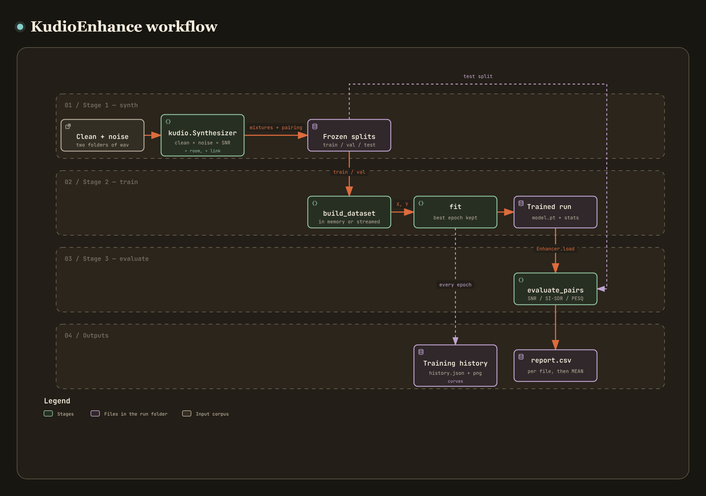

# kudio-enhance

**English** | [繁體中文](README.zh-TW.md)

[](https://www.python.org/)
[](https://pytorch.org/)
[](LICENSE.txt)
[](https://pypi.org/project/kudio/)

**Train and run learned speech-enhancement (denoising) models**, built on the
[`kudio`](https://pypi.org/project/kudio/) audio toolkit.

Three stages, one config file:

[](https://raw.githack.com/recklight/KudioEnhance/master/docs/workflow.html?theme=dark)

The figure is a link to an interactive version — [open it online](https://raw.githack.com/recklight/KudioEnhance/master/docs/workflow.html?theme=dark), or open [`docs/workflow.html`](docs/workflow.html) from a checkout. You can zoom, search for a node, or trace the path between two of them, and most boxes carry a link to the lines of source they were drawn from, at the commit they were checked against.

Each stage reads what the one before it wrote, so you can re-train without
re-mixing and re-evaluate without re-training. `run` does all three in order.

Models work in the **log-power spectrogram domain** and reuse the noisy phase —
the standard magnitude-only enhancement setup. Feature extraction and
reconstruction both go through `kudio`, so what the model sees is exactly what
any other kudio-based tool produces.

## Install

Not on PyPI. Clone it and install from the checkout:

```bash
git clone https://github.com/recklight/KudioEnhance.git
cd KudioEnhance
pip install -e ".[dev]"
```

Needs **Python 3.9+** and **PyTorch ≥ 2.4.1**. The models are plain
`torch.nn` modules, trained by a loop in this package — no Keras, no
Lightning. Older torch wheels, and 2.4.0's on Windows, were built against
NumPy 1, which nothing stops pip from installing beside NumPy 2, and there
they fail at the first `torch.from_numpy`.

On Linux the default `torch` wheel bundles CUDA and runs to several
gigabytes. Without an NVIDIA GPU, install the CPU-only build **first** and pip
will keep it when it installs this package:

```bash
pip install torch --index-url https://download.pytorch.org/whl/cpu
pip install -e ".[dev]"
```

The Windows and macOS wheels on PyPI carry no CUDA, so they stay small.
Training takes an NVIDIA GPU whenever torch can see one (`device: auto` in the
`train` section), so the same config works on both kinds of machine. Apple's
GPUs are not used: torch can drive them through `mps`, but this package does
not ask it to, and on a Mac training runs on the CPU.

STOI and SDR are optional: `pip install -e ".[eval]"`. **PESQ is a
separate extra**, `pip install "kudio[pesq]"`, because it builds from source
— a C compiler, and the MSVC Build Tools on Windows — so it is deliberately
left out of `[eval]` and `[all]`, which would otherwise stop installing.

PESQ comes on two scales. `evaluate` reports MOS-LQO by default; pass
`--pesq-scale raw` for the narrowband P.862 score most enhancement papers
quote. They are different scales, not different roundings: raw 2.03 is about
1.65 MOS-LQO.

## Quick start

```bash
kudio-enhance init config.yaml        # starter config
kudio-enhance run -c config.yaml -n exp1
```

That mixes the dataset, trains, and prints the before/after scores:

```
si_sdr      -4.812 ->    6.933  (+11.745)
snr         -4.998 ->    5.221  (+10.219)
seg_snr     -6.114 ->    1.870  (+7.984)
report -> runs/exp1/report.csv
```

Then denoise anything with the trained run:

```bash
kudio-enhance denoise runs/exp1 noisy.wav enhanced.wav
kudio-enhance denoise runs/exp1 noisy/ clean/ --recursive --report
```

The folder form loads the model **once** for the whole tree, mirrors the input's
directory structure, and with `--report` says how far the noise floor moved.

And afterwards, whether it actually learned anything:

```bash
kudio-enhance curves -c config.yaml -n exp1
```

```
3 epoch(s), monitoring val_loss
  best   0.12172 at epoch 3
  first  0.28104   last 0.12172
```

A training loop hands back its curves and almost every script drops them,
which makes "did it converge, or stop early because validation was already
climbing?" unanswerable the moment the terminal closes. They are written to
`runs/exp1/history.json` (and `history.png` when matplotlib is around). If the
best epoch was the *first* one the command says so and exits non-zero — that is
what "this did not learn" looks like.

### Stage by stage

```bash
kudio-enhance synth    -c config.yaml -n exp1   # mix + freeze the splits
kudio-enhance train    -c config.yaml -n exp1   # fit (--epochs 1 to smoke-test)
kudio-enhance evaluate -c config.yaml -n exp1   # score (--full adds PESQ/STOI)
```

Each stage reads what the previous one wrote, so you can re-train without
re-mixing, or re-evaluate without re-training.

## Configuration

```yaml
audio:                      # STFT geometry, shared by features and reconstruction
  sr: 16000
  n_fft: 512
  hop_length: 256
  win_length: 512

data:
  clean_dir: data/clean
  noise_dir: data/noise
  mixed_dir: runs/mixed
  snr_db: [-5, 0, 5]
  rt60: []                  # reverberation times in seconds; [] = no rooms
  drr_db: 0.0               # how close the microphone is, in dB
  reverberant_target: false # train to remove the noise and leave the room
  channel: null             # telephone / voip / mu_law / a_law, or null
  mode: regular             # 'regular' = one mix per clean file; 'inc' = every combination
  seed: 17                  # makes the mixture and the splits reproducible
  val_split: 0.1
  test_split: 0.1

model:
  name: ddae                # ddae | blstm | conv_ae | crn | unet
  target: spectrum          # spectrum | irm  -- see "What the network is asked to produce"
  context: 2                # frame-wise models: ±frames stacked into the input
  n_frames: 64              # sequence models: frames per training window
  units: null               # layer widths; null = the architecture's default
  dropout: 0.1

train:
  epochs: 50
  batch_size: 256           # ddae needs 2 or more; the sequence models train on 1
  learning_rate: 0.001
  patience: 8
  out_dir: runs
  device: auto              # auto | cpu | cuda | cuda:1
  seed: null                # weights, dropout and batch order; null = data.seed
  streaming: false          # true: read the features from disk every epoch
  shuffle_buffer: 0         # streaming only: examples held back for mixing
```

Every key is a typed dataclass field. A typo fails at load time and names the
offending key — it does not silently fall back to a default three stages later.

## Models

```bash
kudio-enhance models
```

```
blstm       stacked bidirectional LSTM                       units: [1024, 1024, 1024]
conv_ae     dilated Conv1D autoencoder, residual             units: [1024, 1024, 1024]
crn         causal conv-recurrent network (Tan & Wang 2018)  units: [16, 32, 64, 64, 64]
ddae        dense denoising autoencoder, frame-wise          units: [1024, 1024, 1024]
unet        2-D U-Net over time and frequency, non-causal    units: [16, 32, 64, 128]
```

| Name | Input layout | Causal | What it is, and when to choose it |
|---|---|---|---|
| `ddae` | `(N, bins × (2·context+1))` | no — sees ±`context` frames | Dense denoising autoencoder. Frame-wise, fast, a solid baseline. |
| `blstm` | `(N, n_frames, bins)` | no | Stacked bidirectional LSTM. Temporal context in both directions. |
| `conv_ae` | `(N, n_frames, bins)` | no | Dilated Conv1D autoencoder with a residual connection — starts from "pass the signal through" rather than from noise. |
| `crn` | `(N, n_frames, bins)` | **yes** | Convolutional recurrent network after Tan & Wang, *A convolutional recurrent neural network for real-time speech enhancement* (Interspeech 2018): a strided 2-D convolutional encoder over time and frequency, an LSTM over time, and a mirrored decoder that takes each encoder layer's output back in. Choose it when the output must not wait for what comes next. |
| `unet` | `(N, n_frames, bins)` | no — about 50 frames ahead | 2-D U-Net over time and frequency: convolution blocks, halving both axes on the way down, skip connections on the way back up. Choose it for offline enhancement of whole files; at about half a million parameters it is also the smallest model here at the default widths. |

Sequence models are trained on fixed-length windows, but nothing in them
fixes the length of the time axis, so the same weights enhance a whole
utterance in one pass. The two 2-D models also take any `n_fft`: they pad
time and frequency internally as far as their halvings need, and crop back.

**Causal** means the output for a frame depends on that frame and earlier
ones only — the convolutions in `crn` are padded on the past side, its LSTM
runs forwards, and a test holds it to that. It is what a real-time port
needs, but this package does not stream: `Enhancer` still enhances a whole
file at once, and the STFT adds a window of latency of its own.

**`model.units`** is the list of layer widths: a dense layer's units, an
LSTM's, a convolution's filters or channels. Left as `null` it takes the
architecture's default, listed above. A width of 1024 is sensible for a
dense layer and absurd for a 2-D convolution, each of whose channels is a
whole time-frequency map, so the default belongs to the architecture. Set it
to a list to choose the widths yourself. Training writes the widths it
actually built into the run's `config.yaml`, so a run keeps loading even if a
later release changes a default.

`crn`'s LSTM reads every channel at every bin left after halving the bins
once per layer, so its size grows with `n_fft`: about 1.8M parameters at
`n_fft: 256`, 5.5M at 512 and 19M at 1024. For a large `n_fft`, add a layer
to halve once more — `units: [16, 32, 64, 64, 64, 64]` brings 1024 back to
5.6M. Nothing in `unet` depends on the number of bins.

Adding an architecture is a builder function plus one `REGISTRY` entry —
there is no `if/elif` chain to extend in three places. The entry's
`default_units` is what `units: null` builds; leave it out and the
architecture gets the 1024-wide stack the first three share.

### What the network is asked to produce

`model.target` is a separate choice from `model.name`, and every architecture
supports both:

| Target | The network outputs | |
|---|---|---|
| `spectrum` | the clean log-power spectrogram, directly | unbounded output; it has to learn the *level* as well as the shape |
| `irm` | an **ideal ratio mask** in `[0, 1]` | bounded, so a sigmoid cannot produce an impossible answer, and the level comes from the input |

```yaml
model:
  name: ddae
  target: irm
```

The mask is `sqrt(|S|² / (|S|² + |N|²))` — how much of each time-frequency bin
is speech — and applying it is an addition in the log domain, so the network
only ever decides *how much to keep*.

**Measured on this repo's own smoke corpus, three epochs of a small `ddae`:**

| target | SI-SDR |
|---|---|
| `spectrum` | +0.05 → **−7.59 dB** |
| `irm` | +0.05 → **+2.61 dB** |
| an oracle mask | −3.02 → **+14.16 dB** |

An undertrained spectrum model has not learned the level yet, so it outputs
something loud and wrong; an undertrained mask model is already useful, because
the worst it can do is keep or drop what was already there. The oracle row is
the ceiling this target aims at.

That is a tiny model on a tiny corpus, not a benchmark — but it is the reason
mask targets are the usual choice, made visible in about twenty seconds.

## Rooms

Noise is additive and a room is convolutive, and a real recording has both.
`data.rt60` puts the speech through a room before the noise is mixed in:

```yaml
data:
  snr_db: [-5, 0, 5]
  rt60: [0.3, 0.6, 0.9]     # a fourth axis -- in `inc` mode, x3 the files
  drr_db: 0.0               # +10 is a close mic, 0 is a metre or two
```

The SNR is then measured against the **reverberant** speech, because that is
what is competing with the noise at the microphone.

**By default the clean file stays the target.** A model trained on that is
asked to undo the room as well as the noise, which is a standard setup and a
choice worth making on purpose rather than discovering.

`reverberant_target: true` changes it. `kudio.Synthesizer` then writes the
reverberant-but-clean signal to `TARGETS/` beside each mixture — the same
speech with the room left on — and training asks the model to remove the
noise and **leave** the room, which is a different and easier problem, and
the honest one when the deployment keeps its room.

It also makes the `irm` target correct. The mask is built from
`noisy - reference`, and with a room on the speech the dry clean file is not
what was mixed, so that subtraction hands the reverberation to the *noise*
and the mask asks the model to strip the room's own tail as if it were noise.
Against the reverberant target the subtraction is the noise again.

Each mixture records the room it was built in — `Pair.rt60`, and the file name
carries it too (`speech_white_0dB_rt600ms.wav`), so a manifest says what every
example was asked to survive.

## The channel

The third kind of degradation, and the one that is neither additive nor
convolutive: a codec quantises, a link drops packets, a converter throws bits
away.

```yaml
data:
  channel: telephone        # 300-3400 Hz at 8 kHz through G.711
```

`telephone`, `telephone_a`, `voip` (G.711 with 5% of packets lost in runs of
four, held), `mu_law`, `a_law`. It is applied to the **mixture**, noise and
all, because a wire carries whatever reached the microphone.

**It is not an axis.** Unlike `snr_db` and `rt60` it is constant for the
dataset and does not appear in the file names: a corpus is recorded over a
phone line or it is not. `Pair.channel` records which link, and the target
does not go down it — asking a model to reproduce G.711 is not denoising.

## Datasets

Point `clean_dir` and `noise_dir` at any two folders. Public sets that work
well out of the box:

- **[VoiceBank-DEMAND](https://datashare.ed.ac.uk/handle/10283/2791)** — the standard speech-enhancement benchmark (comes pre-mixed; use its clean/noisy folders directly and skip the synth stage).
- **[LibriSpeech](https://www.openslr.org/12/)** + **[DEMAND](https://zenodo.org/record/1227121)** or **[MUSAN](https://www.openslr.org/17/)** — mix them yourself at the SNRs you care about.
- **[ESC-50](https://github.com/karolpiczak/ESC-50)** — environmental noise, handy for non-speech targets.

Set a `seed` and the mixture is reproducible: the same noise offsets, the same
pairings, the same splits.

## Training data: in memory or streamed

By default training holds its features in memory: they are computed once,
and every epoch is a full shuffle of the whole set. That is the right choice
for the tens of hours these models are normally trained on.

A frame-wise model (`ddae`) sees every frame with its ±`context` neighbours,
and stacking those for the whole set up front used to multiply the memory by
`2·context + 1` — eleven times over at `context: 5`. The training set now
keeps each frame once, in a `kudio.ContextFrames`, and stacks the neighbours
of the rows a batch draws as it draws them. The rows are the same, and so is
the run: a test holds the set to the stacked matrix row for row, and fitting
on either gives the same weights to the last bit. Sequence models' windows
were never larger than their features.

What is left is the features themselves, input and target: at 16 kHz with
the default STFT, about 0.46 GB per hour of training audio. When that does
not fit, stream:

```yaml
train:
  streaming: true
  shuffle_buffer: 25000     # a hundred 4-second files of ddae frames
```

Nothing is held then. Every epoch reads the training files again, in a fresh
order, and computes each one's examples as it goes — the same examples, row
for row, as the in-memory set. The price is that pass over the audio, every
epoch: reading, resampling and the STFT, done by the training process between
batches.

- **The normalisation** is fitted by one extra pass before the first epoch, a
  file at a time. It is kudio's formula — the mean, the population standard
  deviation and the same `1e-8` added to it — summed in float64, and an
  in-memory run fits it the same way, a file's spectrogram at a time, so the
  two modes normalise with the same statistics to the bit. (kudio's own
  `Standardizer.fit` sums in float32, and on an hour of frames drifts from
  the true statistics by a few parts in 10⁵; this stays within a part in
  10⁷.)
- **Validation** is streamed too, in manifest order, and its batches fall
  exactly where the in-memory set's would, so it scores what the in-memory
  set would score.
- **The shuffle buffer.** Each file's examples join a pool, and every batch is
  drawn at random from everything in it, for as long as at least
  `shuffle_buffer` examples would be left waiting; when the files run out the
  rest goes out in random order. An example is a frame for `ddae` and an
  `n_frames` window for the sequence models. To mix well, let the buffer span
  a hundred files or so: a hundred times the frames in a typical file, or
  the windows in one. It costs that many inputs and targets of memory: 6 KB
  an example for `ddae` at 257 bins and `context: 2`, 132 KB for a 64-frame
  window.
- **`shuffle_buffer: 0` holds nothing back.** The files still come in a fresh
  order and each file's examples are shuffled, but every batch is drawn from
  the file being read and what earlier draws left over, less than a batch —
  neighbouring frames of one recording, which trains worse. Training warns
  when it is asked for. In memory the setting is not used.
- **It repeats.** The order of the files and every draw from the pool come
  from `train.seed`, so a streamed run repeats to the last digit on the CPU,
  as an in-memory one does. It is a different run from the in-memory one,
  though: the same examples, in a different order.

`kudio_enhance.data.build_dataset` is what both modes go through, and
`train.fit` takes what it returns in place of arrays:

```python
from kudio_enhance.data import build_dataset
from kudio_enhance.train import fit

train_set, std = build_dataset(train_pairs, cfg, sequence=False, fit=True)
history = fit(model, train_set, None, cfg, "runs/exp1/ddae.pt")
```

`build_arrays` still returns the plain stacked matrices, for code that wants
them.

## Python API

```python
from kudio_enhance import Config, Enhancer, pipeline

cfg = Config.from_yaml("config.yaml")
summary = pipeline.run(cfg, "exp1")          # synth + train + evaluate

enh = Enhancer.load("runs/exp1")             # model + stats + config together
clean = enh.enhance_file("noisy.wav", "enhanced.wav")
result = enh.enhance_folder("noisy/", "clean/", report=True)
print(result, result.mean_reduction_db())
```

The model is loaded once for the whole tree, and the result is a
`kudio.EnhanceFolderResult` — the same shape `kudio.convert_folder` returns, so
"I processed a folder" has one answer whatever did the processing.

A trained run also drops straight into kudio's comparison table, beside the
statistical methods:

```python
import kudio
kudio.compare_enhancers(y, sr, ['logmmse', ('exp1', enh.enhance)],
                        reference=clean)
```

`Enhancer.load` reads the model, its normalisation statistics **and** the STFT
geometry that produced them from the same run directory, so inference can never
silently disagree with training.

### What a run directory holds

```
runs/exp1/
├── config.yaml      # the experiment, as it was trained
├── ddae.pt          # the weights: <model.name>.pt
├── stats.npz        # the Standardizer the features went through
├── history.json     # the curves (and history.png with matplotlib)
├── train.json  val.json  test.json  manifest.json
└── report.csv       # after evaluate
```

The `.pt` file is a plain dictionary — a format tag, the architecture and
target it was trained as, and a `state_dict` — read back with
`torch.load(..., weights_only=True)`. Nothing in it is a pickled class, so
opening a run somebody sent you cannot run their code, and `Enhancer.load`
rebuilds the network from `config.yaml` before pouring the weights in. It is
also the best epoch, always: training checkpoints whenever the monitored loss
improves and puts those weights back into the model when it stops.

Set `train.seed` (or just `data.seed`) and the initial weights, the dropout
masks and the order of the batches all come from it, so on the CPU a run
repeats to the last digit. Some GPU kernels are not deterministic, so there
it repeats closely rather than exactly.

## Layout

```
docs/
├── images/workflow.png  # the README figure
└── workflow.html        # the same diagram, interactive
src/kudio_enhance/
├── config.py        # typed dataclasses, YAML in/out, run paths
├── data.py          # mixing, manifests, splits, training sets
├── datasets.py      # the training set as torch sees it: held or streamed
├── features.py      # spectrogram / context stacking / windows / Standardizer
├── models/
│   ├── registry.py      # name -> builder + data layout
│   ├── dense.py         # ddae
│   ├── recurrent.py     # blstm
│   ├── convolutional.py # conv_ae
│   ├── crn.py           # crn
│   └── unet.py          # unet
├── train.py         # the training loop: Adam, checkpoints, early stopping
├── checkpoint.py    # the .pt format
├── inference.py     # Enhancer
├── evaluate.py      # per-file scoring + CSV report
├── pipeline.py      # the three stages
└── cli.py           # kudio-enhance
```

Model builders return plain `torch.nn.Module`s; `train.py` owns the
optimiser, the loss and the loop. That keeps architectures inspectable without
committing to an optimisation setup.

## Tests

```bash
pytest -q
```

228 tests. The suite builds a tiny synthetic corpus in a temp directory and runs
the whole pipeline — mix, train one epoch, enhance, score — in seconds. Tests
that need PyTorch ask for it by name and skip cleanly when it is not
installed; the other 105 still run.

The mask tests check the *formula*, not just that it runs: all-speech gives 1,
all-noise gives 0, equal power gives 1/√2, and an oracle mask has to actually
improve SI-SDR. Those hold or the target is wrong, whatever the loss curve
says. The architecture tests work the same way: change any frame after *t*
and `crn`'s output up to *t* has to stay the same bit for bit, while
`unet`'s has to move, because its description says it is non-causal. And the
training sets: the in-memory one has to hand back the stacked matrix's rows
bit for bit, so does a streamed pass in manifest order, and a shuffled epoch
has to be every example exactly once, in the same order again from the same
seed. The two modes have to normalise with the same statistics, to the bit.

## Known limits

- A streamed epoch reads and transforms its files in the training process,
  one at a time, between batches. There are no loader worker processes, so a
  GPU can end up waiting on the CPU; an in-memory run pays that cost once.
- Magnitude-only enhancement: the phase is the noisy input's. Phase-aware or
  time-domain models are a different architecture family.
- Sequence models enhance a whole file in one pass. For `crn` and `unet` that
  means a feature map per channel per bin for every frame: about half a
  gigabyte per minute of 16 kHz audio at the default widths, so split long
  recordings before enhancing them.
- The `irm` target needs the noise, and takes it as `noisy - reference` in the
  time domain. That is exact for anything `kudio.Synthesizer` mixed, and wrong
  for a corpus whose noisy and clean files are separate recordings rather than
  a sum. In a reverberant dataset the reference has to be the reverberant
  target, or the room's tail is handed to the noise -- see
  `reverberant_target` above.

### Since 0.2.0

The models are **native PyTorch**; 0.1 was TensorFlow and Keras 3. The configs
are unchanged — `train.device` and `train.seed` are new and optional — and so
are the architectures, down to Keras's initialisation, BatchNorm momentum and
LSTM forget-gate bias, so a config tuned on 0.1 keeps its meaning on 0.2 —
though not its exact numbers, since the two frameworks' kernels differ.

The weights are not. A run directory trained by 0.1 holds `ddae.keras` and no
`ddae.pt`, and `Enhancer.load` says so and asks for a retrain rather than
reporting a missing file. The config and the frozen splits in it can be
reused as they are:

```bash
kudio-enhance train -c runs/exp1/config.yaml -n exp1
```

`fit` returns the curves as a plain dict instead of a Keras `History`, and
`compile_model` is a deprecated no-op kept so 0.1-era scripts that call
`fit(compile_model(...))` still run. `build_callbacks` is gone, and importing
it fails: `fit` does the checkpointing, the early stopping and the
learning-rate halving itself, so code that built Keras callbacks for
`model.fit` calls `kudio_enhance.train.fit` instead.

`train.batch_size` has to be 2 or more for `ddae`, and training says so before
it reads any audio; a `ddae` training set of a single frame is refused too.
Its BatchNorm takes a variance over the batch, and one example has none. 0.1
accepted a batch size of 1, but Keras normalised each unit to a constant
there, so nothing below the last BatchNorm ever trained. The sequence models
still train on a batch of one window.

The normalisation statistics are now summed in float64 in memory as well as
streamed, so the same training set gives a `stats.npz` a little different
from 0.1's: a few parts in 10⁵ on an hour of audio, less on a smaller set.

Training goes through `build_dataset` instead of `build_arrays`, so a
frame-wise model's context is no longer stacked for the whole set in memory;
the run is the same to the last digit. `fit` takes the dataset in place of
`x` with `y=None`, and still takes arrays. `train.streaming` is new, and
`train.shuffle_buffer`, which was in the config but read by nothing, now
sizes the streamed shuffle — and only that.

Two architectures are new, `crn` and `unet`, and `model.units` now defaults
to `null`, meaning the architecture's own widths. A config that sets `units`
builds what it did, and so does one that left it out: `ddae`, `blstm` and
`conv_ae` still default to `[1024, 1024, 1024]`. Code that reads
`cfg.model.units` directly can now find `None` there;
`kudio_enhance.models.resolve_units(cfg)` returns a copy with the widths
spelled out.

### Since 3.5.0

`Pair`, `save_manifest`, `load_manifest` and `split_pairs` now come from
**kudio** — nothing in them was specific to denoising. The JSON on disk is
unchanged and the names are still importable from `kudio_enhance.data`, but
kudio's `split_pairs` is stricter: `val_split + test_split >= 1.0` raises
instead of quietly handing everything to training.

## Related

- **[kudio](https://pypi.org/project/kudio/)** — the audio toolkit underneath.
- **[KudioStudio](https://github.com/recklight/KudioStudio)** — desktop workbench
  for the same toolkit. With this package installed alongside it, its Enhance
  panel loads the run directories produced here, so you can listen to a model's
  output and score it interactively instead of only reading the CSV.

## Licence

MIT — see [LICENSE.txt](LICENSE.txt).
