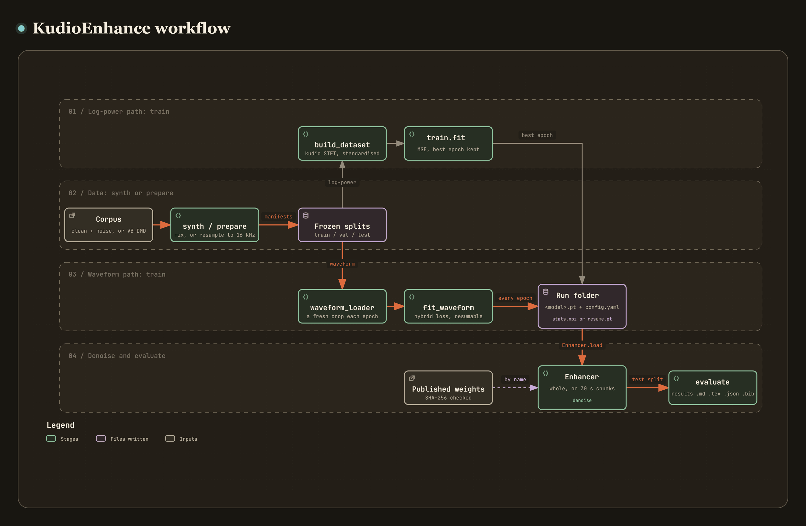

# KudioEnhance

[English](https://github.com/recklight/KudioEnhance/blob/master/README.md) | **繁體中文**

[](https://pypi.org/project/kudioenhance/)
[](https://www.python.org/)
[](https://pytorch.org/)
[](https://github.com/recklight/KudioEnhance/blob/master/LICENSE.txt)
[](https://pypi.org/project/kudio/)

**訓練並執行學習式語音增強（降噪）模型**，建立在
[`kudio`](https://pypi.org/project/kudio/) 音訊工具包之上；也可以直接用這裡訓練好的權重降噪。

三個階段，一個設定檔：

[](https://raw.githack.com/recklight/KudioEnhance/master/docs/workflow.html?theme=dark)

這張圖連到互動版本——[線上開啟](https://raw.githack.com/recklight/KudioEnhance/master/docs/workflow.html?theme=dark)，或在 clone 下來的專案中開啟 `docs/workflow.html`。可以縮放、搜尋節點、追蹤兩個節點之間的路徑，而且大多數方塊都連到它所依據的原始碼行，並固定在當時核對的 commit。

每個階段讀取前一個階段寫出的結果，所以可以不重新混音就重新訓練，也可以不重新訓練就重新評估。`run` 會依序執行三個階段。

模型分兩條路徑。其中五個在 **log-power 頻譜域** 運作，並沿用含噪訊號的相位——這是標準的「只處理幅度」增強做法。特徵擷取與重建都經過 `kudio`，所以模型看到的，和任何以 kudio 為基礎的工具產生的完全相同。第六個 `gtcrn` 讀**複數頻譜**、輸出複數遮罩、用波形訓練。它只有 23,669 個權重，CPU 就訓練得動，在 VoiceBank-DEMAND 上訓練好的權重也有公開（見「預訓練權重」）。「兩條路徑」一節把兩者並排比較，「VoiceBank-DEMAND 上的結果」一節有兩者的分數。

這一頁講安裝、公開的權重、三個階段怎麼跑和結果。其餘的在[使用指南](https://github.com/recklight/KudioEnhance/blob/master/docs/guide.zh-TW.md)：`evaluate` 寫出什麼、模型和兩條路徑的細節、房間與通道、串流、run 目錄和專案結構。

## 安裝

```bash
pip install kudioenhance
```

指令是 `kudioenhance`，套件則是 `import kudioenhance`。

需要 **Python 3.9+** 與 **PyTorch ≥ 2.4.1**。模型是單純的 `torch.nn` 模組，由本套件自己的訓練迴圈訓練——不用 Keras，也不用 Lightning。更舊的 torch wheel，以及 Windows 上的 2.4.0，是針對 NumPy 1 編譯的；pip 不會阻止它們和 NumPy 2 裝在一起，結果會在第一次 `torch.from_numpy` 時失敗。

在 Linux 上，預設的 `torch` wheel 內含 CUDA，大小達數 GB。沒有 NVIDIA GPU 的話，請**先**安裝 CPU 版，pip 在安裝本套件時會保留它：

```bash
pip install torch --index-url https://download.pytorch.org/whl/cpu
pip install kudioenhance
```

PyPI 上的 Windows 與 macOS wheel 不含 CUDA，所以體積很小。只要 torch 偵測得到 NVIDIA GPU，訓練就會使用它（`train` 區段的 `device: auto`），因此同一份設定在兩種機器上都能用。Apple 的 GPU 不會被使用：torch 可以透過 `mps` 使用它，但本套件不會要求這麼做，在 Mac 上訓練會跑在 CPU。

STOI 與 SDR 是選用的：`pip install "kudioenhance[eval]"`。**PESQ 是另一個獨立的 extra**，`pip install "kudio[pesq]"`，因為它要從原始碼編譯——需要 C 編譯器，在 Windows 上是 MSVC Build Tools——所以刻意不放進 `[eval]` 和 `[all]`，否則它們會裝不起來。

PESQ 有兩種尺度。`evaluate` 預設回報 MOS-LQO；加上 `--pesq-scale raw` 則是經過 P.862.1 映射之前的窄頻 P.862 分數。它們是不同的尺度，不是四捨五入的差別：raw 2.03 大約等於 MOS-LQO 1.66。論文兩種都有人用，拿自己的數字去比之前，先確認對方用的是哪一種。

## 預訓練權重

不訓練、直接降噪：

```bash
kudioenhance pretrained                          # 列出公開的權重，以及快取裡有哪些
kudioenhance denoise gtcrn-vbd16k noisy.wav enhanced.wav
kudioenhance denoise gtcrn-vbd16k noisy/ clean/ --recursive
```

| 名稱 | 模型 | 訓練資料 | WB-PESQ | 授權 | |
|---|---|---|---|---|---|
| `gtcrn-vbd16k` | `gtcrn`，23,669 個權重，16 kHz，因果 | VoiceBank-DEMAND，26 位說話者，在 CPU 上訓練 | 測試集 2.77 | CC BY 4.0 | [模型卡](https://github.com/recklight/KudioEnhance/blob/master/docs/models/gtcrn-vbd16k.md) |

第一次使用時會把檔案下載到快取 `~/.cache/kudioenhance`（用 `$KUDIOENHANCE_CACHE` 或 `$XDG_CACHE_HOME` 換位置，或兩個指令都加 `--cache DIR`）；要在之後會離線的機器上用，先跑 `kudioenhance pretrained gtcrn-vbd16k` 下載好。檔案就是訓練那個 run 寫出的 `.pt`，原封不動，它的 SHA-256 寫在發布的版本裡：下載完先核對才留下，之後每次從快取載入都再核對一次，磁碟上的檔案被改過就重新下載，不會拿來用。凡是能放 run 目錄的地方，`denoise` 和 `Enhancer.load`，都能放這個名稱；同名的資料夾優先。在 Python 裡：

```python
from kudioenhance import Enhancer

enh = Enhancer.pretrained("gtcrn-vbd16k")
enh.enhance_file("noisy.wav", "enhanced.wav")
```

只公開波形路徑的權重。log-power 模型還需要它那個 run 的正規化統計量，而一筆權重只對應一個檔案。權重採 CC BY 4.0，和訓練資料相同，這個授權要求註明資料出處；模型卡裡有訓練的 run、附 kudio signature 的分數，以及要引用什麼。

## 快速開始

```bash
kudioenhance init config.yaml        # 產生起始設定檔
kudioenhance run -c config.yaml -n exp1
```

這會混出資料集、訓練，並印出前後的分數：

```
si_sdr      -4.812 ->    6.933  (+11.745)
snr         -4.998 ->    5.221  (+10.219)
seg_snr     -6.114 ->    1.870  (+7.984)
report -> runs/exp1/report.csv
table  -> runs/exp1/results.md (.tex, .json, .bib beside it)
```

接著用訓練好的 run 對任何音訊降噪：

```bash
kudioenhance denoise runs/exp1 noisy.wav enhanced.wav
kudioenhance denoise runs/exp1 noisy/ clean/ --recursive --report
```

資料夾模式對整棵目錄樹只載入模型**一次**，輸出會鏡像輸入的目錄結構，加上 `--report` 會告訴你噪音底降了多少。

之後再確認它到底有沒有學到東西：

```bash
kudioenhance curves -c config.yaml -n exp1
```

```
3 epoch(s), monitoring val_loss
  best   0.12172 at epoch 3
  first  0.28104   last 0.12172
```

訓練迴圈會交回訓練曲線，但幾乎每個腳本都把它丟掉，於是終端機一關，「它收斂了嗎？還是因為驗證損失已經在上升而提早停止？」就再也無從回答。曲線會寫到 `runs/exp1/history.json`（有 matplotlib 時另存 `history.png`）。如果最好的 epoch 是*第一個*，這個指令會明說並以非零狀態結束——那就是「沒有學到東西」的樣子。

### 逐階段執行

```bash
kudioenhance synth    -c config.yaml -n exp1   # 混音並固定資料切分
kudioenhance train    -c config.yaml -n exp1   # 訓練（--epochs 1 可做冒煙測試）
kudioenhance evaluate -c config.yaml -n exp1   # 評分（--full 加上 PESQ、STOI 等）
```

每個階段讀取前一個階段寫出的結果，所以可以不重新混音就重新訓練，或不重新訓練就重新評估。

`evaluate` 把增強後的測試集寫到 `runs/exp1/enhanced/`，逐檔分數寫到 `report.csv`，結果表（附 95% 區間、符號翻轉檢定和 kudio 的 signature）寫成 `results.md`、`.tex`、`.json` 和 `.bib`。`--full` 加上 PESQ、CSIG/CBAK/COVL、STOI 和 SDR，`--dnsmos-dir` 加上 DNSMOS；各個選項和區間怎麼重抽，見[使用指南](https://github.com/recklight/KudioEnhance/blob/master/docs/guide.zh-TW.md)的「`evaluate` 寫出什麼」。

## VoiceBank-DEMAND 上的結果

測試集 824 句、16 kHz，用 `kudioenhance prepare` 準備，經 `kudioenhance evaluate --full --dnsmos-dir ...` 以 kudio 4.0.0 評分。每個 checkpoint 都是用從訓練說話者留出的兩位驗證說話者挑的，從沒看過測試集；全部在一顆 CPU（Intel Core i5-13600K）上訓練，沒有 GPU。

| | 權重數 | WB-PESQ | CSIG | CBAK | COVL | SSNR | STOI | SI-SDR | DNSMOS OVRL |
|---|---|---|---|---|---|---|---|---|---|
| Noisy | – | 1.97 | 3.33 | 2.44 | 2.62 | 1.68 | 0.921 | 8.45 | 2.70 |
| `unet`，`irm` | 483K | 2.65 [2.61, 2.70] | 4.03 | 3.26 | 3.35 | 8.19 | 0.940 | 17.23 | 3.07 |
| `crn`，`irm` | 5.51M | 2.70 [2.66, 2.75] | 4.14 | 3.28 | 3.44 | 7.98 | 0.941 | 16.69 | 3.06 |
| `gtcrn`（`gtcrn-vbd16k`） | 23,669 | **2.77** [2.73, 2.81] | 4.09 | 3.41 | 3.43 | 9.85 | 0.939 | 18.69 | 3.07 |

- 括號是按句子重抽的 95% BCa 區間；每個 run 自己的 `results.md` 每一格都有，[模型卡](https://github.com/recklight/KudioEnhance/blob/master/docs/models/gtcrn-vbd16k.md)印了 `gtcrn` 的整張表和 kudio 的 signature。那些表裡和 noisy 的差，經 Holm 調整後全部顯著，只有 `gtcrn` 的 DNSMOS SIG 例外。
- SSNR 是 Loizou `composite.m` 的段落 SNR，也就是 `kudio.composite(...).segsnr`，這個測試集的論文印的就是這一欄。`evaluate` 表上的 segSNR 是 kudio 的 `segsnr`，框法不同，noisy 檔是 1.56。
- Noisy 那一列就是公開的那一列：1.97、2.44、1.68、0.921、8.45，CSIG 與 COVL 約低 0.01。這裡的 16 kHz 檔是 32 位元浮點；CMGAN 那一列的逐檔 log 對得上的是加了抖動的 16 位元檔，它的底噪會讓接近無聲的框裡的 CSIG、COVL 變動。
- `unet` 和 `crn` 走 log-power 路徑、`irm` 目標，`n_fft: 512`、`hop_length: 256`、64 幀視窗、batch 16、最多 40 個 epoch、patience 8、串流讀檔。兩個同時訓練、各用 4 個執行緒：`crn` 跑 24 個 epoch 後停（最佳在第 16），10.5 小時；`unet` 跑滿 40 個（最佳在第 39，還在進步），16.3 小時。
- `gtcrn` 用[使用指南](https://github.com/recklight/KudioEnhance/blob/master/docs/guide.zh-TW.md)「波形路徑：`gtcrn`」一節的設定、2 個執行緒訓練：61 個 epoch 後停（最佳在第 51），14 小時 45 分。

同一個測試集上公開的輕量模型結果，照 GTCRN 論文和它的 repo 印的：

| | 權重數 | WB-PESQ | STOI | SI-SNR |
|---|---|---|---|---|
| RNNoise | 0.06M | 2.29 | | |
| PercepNet | 8.00M | 2.73 | | |
| DeepFilterNet | 1.80M | 2.81 | | |
| S-DCCRN | 2.34M | 2.84 | | |
| GTCRN | 23.7K | 2.87 | 0.940 | 18.83 |

訓練出來的 `gtcrn`，STOI 和論文差 0.001、SI-SNR 差 0.14 dB，WB-PESQ 卻少了 0.10，論文的數字落在區間外。論文沒寫這個資料集的裁段長度和 epoch 數；這組權重用 2 秒的段、在第 61 個 epoch 停下，GTCRN 的作者在別處建議過約 8 秒的段、200 個 epoch。這樣能不能補上差距，還沒試過。GTCRN 的 repo 寫 48.2K 個權重，那是把兩個固定的 ERB 矩陣也算進去，這裡它們是 buffer。更大的模型分數更高：CMGAN 到 3.41，MP-SENet 用 2.05M 個權重到 3.50。

要重現某一列，先照「VoiceBank-DEMAND」一節準備語料，再訓練、評分：

```bash
kudioenhance train    -c gtcrn.yaml -n vbd-gtcrn
kudioenhance evaluate -c gtcrn.yaml -n vbd-gtcrn --full --jobs 8 --dnsmos-dir models/dnsmos
```

## 設定

```yaml
audio:                      # STFT 幾何參數，特徵擷取與重建共用
  sr: 16000
  n_fft: 512
  hop_length: 256
  win_length: 512

data:
  clean_dir: data/clean
  noise_dir: data/noise
  mixed_dir: runs/mixed
  snr_db: [-5, 0, 5]
  rt60: []                  # 殘響時間（秒）；[] = 不加房間
  drr_db: 0.0               # 麥克風有多近，單位 dB
  reverberant_target: false # 訓練成只去除噪音、保留房間
  channel: null             # telephone / voip / mu_law / a_law，或 null
  mode: regular             # 'regular' = 每個乾淨檔一個混音；'inc' = 所有組合
  seed: 17                  # 讓混音與資料切分可重現
  val_split: 0.1
  test_split: 0.1

model:
  name: ddae                # ddae | blstm | conv_ae | crn | unet | gtcrn
  target: spectrum          # spectrum | irm  -- 見使用指南的 log-power 路徑
  context: 2                # 逐幀模型：前後各堆疊幾幀進輸入
  n_frames: 64              # 序列模型：每個訓練視窗的幀數
  units: null               # 各層寬度；null = 架構的預設值
  dropout: 0.1

train:
  epochs: 50
  batch_size: 256           # ddae 需要 2 以上；序列模型可以用 1
  learning_rate: 0.001
  patience: 8
  out_dir: runs
  device: auto              # auto | cpu | cuda | cuda:1
  seed: null                # 權重、dropout 與批次順序；null = data.seed
  streaming: false          # true：每個 epoch 從磁碟讀取特徵
  shuffle_buffer: 0         # 僅串流模式：保留多少樣本用來打亂
```

每個鍵都是有型別的 dataclass 欄位。打錯字會在載入時失敗並指出是哪個鍵——不會在三個階段之後悄悄改用預設值。`gtcrn` 另有幾個自己的鍵和一個 `loss` 段，列在[使用指南](https://github.com/recklight/KudioEnhance/blob/master/docs/guide.zh-TW.md)的「波形路徑：`gtcrn`」一節。

## 模型

```bash
kudioenhance models
```

```
blstm       stacked bidirectional LSTM (Erdogan et al. 2015)                                  units: [1024, 1024, 1024]
conv_ae     dilated Conv1D autoencoder, residual (after Tan et al. 2019)                      units: [1024, 1024, 1024]
crn         causal conv-recurrent network (Tan & Wang 2018)                                   units: [16, 32, 64, 64, 64]
ddae        dense denoising autoencoder, frame-wise (Xu et al. 2015)                          units: [1024, 1024, 1024]
gtcrn       grouped temporal conv-recurrent network, causal, complex mask (Rong et al. 2024)  units: [16]
unet        2-D U-Net over time and frequency, non-causal (Ronneberger et al. 2015)           units: [16, 32, 64, 128]
```

| 名稱 | 輸入形狀 | 因果 | 是什麼、何時選用 |
|---|---|---|---|
| `ddae` | `(N, bins × (2·context+1))` | 否——看得到前後 `context` 幀 | 全連接網路，從一段連續幀推出中間那一幀，做法同 Xu 等人的 *A regression approach to speech enhancement based on deep neural networks*（IEEE/ACM TASLP 2015）。名稱來自 Lu 等人的 *Speech enhancement based on deep denoising autoencoder*（Interspeech 2013）。逐幀、快速，是穩健的基準。 |
| `blstm` | `(N, n_frames, bins)` | 否 | 堆疊的雙向 LSTM，同 Erdogan 等人的 *Phase-sensitive and recognition-boosted speech separation using deep recurrent neural networks*（ICASSP 2015）。雙向的時間上下文。 |
| `conv_ae` | `(N, n_frames, bins)` | 否 | 帶殘差連接的膨脹 Conv1D 自編碼器——從「讓訊號直接通過」開始學，而不是從雜訊開始。沿時間的卷積是 Tan、Chen 與 Wang 的 *Gated residual networks with dilated convolutions for monaural speech enhancement*（IEEE/ACM TASLP 2019）的簡化版，拿掉了前面的 2-D 卷積和閘門；膨脹率逐層加倍的做法來自 Yu 與 Koltun（ICLR 2016）。 |
| `crn` | `(N, n_frames, bins)` | **是** | 依 Tan & Wang 的卷積遞迴網路（*A convolutional recurrent neural network for real-time speech enhancement*，Interspeech 2018）：在時間與頻率上跨步的 2-D 卷積編碼器、沿時間的 LSTM，以及對稱的解碼器，把每層編碼器的輸出接回來。當輸出不能等待後面的內容時選它。 |
| `unet` | `(N, n_frames, bins)` | 否——約往後看 50 幀 | 時間與頻率上的 2-D U-Net，架構依 Ronneberger 等人的 *U-Net: Convolutional networks for biomedical image segmentation*（MICCAI 2015），用在頻譜上、輸出遮罩的做法同 Jansson 等人的 *Singing voice separation with deep U-Net convolutional networks*（ISMIR 2017）：卷積區塊，往下時兩軸都減半，往上時以跳接接回。適合整檔離線增強；在預設寬度下約五十萬個參數，也是這裡最小的 log-power 模型。 |
| `gtcrn` | 複數頻譜 `(N, bins, frames)` | **是** | 依 Rong 等人的 GTCRN（*GTCRN: A speech enhancement model requiring ultralow computational resources*，ICASSP 2024）：低頻點保留、高頻點併成 ERB 頻帶，接分組時間卷積與遞迴注意力、分組雙路徑 GRU 網路，輸出複數比值遮罩。23,669 個權重，16 kHz 音訊每秒在矩陣乘法與卷積裡 26.3M 次乘加（照 GTCRN repo 的數法，連偏置、正規化、激活函數和 GRU 閘門的運算一起算，是 33.0M）。運算資源很少、或相位也要估計時選它。 |

序列模型用固定視窗訓練、一次處理整段語句，`crn` 和 `gtcrn` 不往後看，`model.units` 設定各層寬度。其餘細節、`crn` 的大小怎麼隨 `n_fft` 變，以及怎麼新增架構，見[使用指南](https://github.com/recklight/KudioEnhance/blob/master/docs/guide.zh-TW.md)的「模型細節」。

## 兩條路徑

| | log-power 路徑 | 波形路徑 |
|---|---|---|
| 模型 | `ddae`、`blstm`、`conv_ae`、`crn`、`unet` | `gtcrn` |
| 網路看到的 | kudio STFT 的 log-power 頻譜，經過標準化 | `torch.stft` 的複數頻譜 |
| 輸出 | log-power 頻譜，或 [0, 1] 的遮罩（`model.target`） | 複數比值遮罩 |
| 相位 | 沿用含噪輸入的 | 自己估的 |
| 訓練資料 | 每個檔案的每一幀，放在記憶體或串流 | 每個 epoch 從每一對檔案重新切一段（`data.crop_seconds`） |
| 損失 | 目標上的 MSE | `loss` 段：壓縮後的複數與幅度 MSE、SI-SNR |
| 統計量 | `stats.npz`，在訓練集上擬合 | 沒有 |
| 中途停掉的 run | 從頭再訓練 | `--resume`，在 CPU 上逐位元接續 |
| 長檔案 | 一次處理 | 切成 30 秒、重疊 1 秒的段 |
| 公開的權重 | – | `gtcrn-vbd16k` |

兩條路徑讀同一個 `audio` 段，框法也相同：預設下，波形路徑用 `torch.stft` 算出的複數值和 kudio 的差在峰值的百萬分之一以內。`train`、`evaluate`、`denoise` 和 `Enhancer` 兩種都收；架構在 registry 裡的那一筆說它走哪條路徑。

兩條路徑各自怎麼訓練，見[使用指南](https://github.com/recklight/KudioEnhance/blob/master/docs/guide.zh-TW.md)：log-power 路徑的 `spectrum` 與 `irm` 目標，以及波形路徑的設定、損失、`--resume`、`progress.json` 和分段推論。

## 資料集

把 `clean_dir` 和 `noise_dir` 指向任意兩個資料夾即可。可直接使用的公開資料集：

- **[VoiceBank-DEMAND](https://datashare.ed.ac.uk/handle/10283/2791)**——標準的語音增強基準。它本身就混好了，所以不走 synth 階段，做法見下方。
- **[LibriSpeech](https://www.openslr.org/12/)** + **[DEMAND](https://zenodo.org/record/1227121)** 或 **[MUSAN](https://www.openslr.org/17/)**——以你關心的 SNR 自行混音。
- **[ESC-50](https://github.com/karolpiczak/ESC-50)**——環境噪音，適合非語音的目標。

設定 `seed` 後混音即可重現：相同的噪音起點、相同的配對、相同的切分。

`synth` 也能讓語音先經過房間（`data.rt60`、`data.drr_db`），再讓混音經過電話或 VoIP 線路（`data.channel`）；兩者對目標的影響，見[使用指南](https://github.com/recklight/KudioEnhance/blob/master/docs/guide.zh-TW.md)的「房間」和「通道」。訓練集大到放不進記憶體時可以串流讀取，見使用指南的「訓練資料：放在記憶體或串流」。

### VoiceBank-DEMAND

28 位說話者的版本要自己從 DataShare 紀錄下載（訓練集和測試集的 clean、noisy zip，加上 `logfiles.zip`），然後：

```bash
kudioenhance prepare path/to/zips data/vbd16k
```

`prepare` 讀 zip 或解開後的資料夾，不會自己下載。48 kHz 的檔案用 soxr 的 HQ 濾波器重抽樣到 16 kHz（其他取樣率用 `--sr`），存成 32 位元浮點：noisy 檔很接近滿刻度，存 16 位元的話重抽樣的過衝會被削掉，`noisy - clean` 就不再是 `irm` 目標拿來當噪音的那個訊號。這個語料沒有驗證集，拿測試集挑 checkpoint 會讓測試分數失去意義，所以從訓練說話者整位留出 p226 和 p287 當驗證集（要換人用 `--val-speakers`），和 SpeechBrain 的 VoiceBank 配方留的是同兩位。

`data/vbd16k` 底下會有 `train/`、`val/`、`test/`，三份 manifest（每一對都帶語料 log 檔裡的噪音種類和 SNR），列出每個檔案 SHA-256 的 `utterances.csv`，`speakers.csv`，以及記下來源 zip 和其 SHA-256、重抽樣器與套件版本的 `prepare.json`。設定檔指向這個資料夾，跳過 `synth`：

```yaml
data:
  prepared: data/vbd16k
```

## Python API

```python
from kudioenhance import Config, Enhancer, pipeline

cfg = Config.from_yaml("config.yaml")
summary = pipeline.run(cfg, "exp1")          # synth + train + evaluate

enh = Enhancer.load("runs/exp1")             # 模型 + 統計量 + 設定一起載入
clean = enh.enhance_file("noisy.wav", "enhanced.wav")
result = enh.enhance_folder("noisy/", "clean/", report=True)
print(result, result.mean_reduction_db())

enh = Enhancer.pretrained("gtcrn-vbd16k")    # 公開的權重，從快取載入
```

整棵目錄樹只載入一次模型，結果是 `kudio.EnhanceFolderResult`——與 `kudio.convert_folder` 回傳的形狀相同，所以不論是誰處理的，「我處理了一個資料夾」都只有一種答案。

訓練好的 run 也能直接放進 kudio 的比較表，和統計式方法並列：

```python
import kudio
kudio.compare_enhancers(y, sr, ['logmmse', ('exp1', enh.enhance)],
                        reference=clean)
```

`Enhancer.load` 從同一個 run 目錄讀取模型、它的正規化統計量，**以及**產生它們的 STFT 幾何參數，所以推論永遠不會悄悄與訓練不一致。

run 目錄裡有什麼、別人傳來的 `.pt` 檔為什麼可以放心打開，見[使用指南](https://github.com/recklight/KudioEnhance/blob/master/docs/guide.zh-TW.md)的「run 目錄裡有什麼」。

## 測試

從原始碼安裝開發用的 extra：

```bash
git clone https://github.com/recklight/KudioEnhance.git
cd KudioEnhance
pip install -e ".[dev]"
pytest -q
```

共 509 個測試。測試套件會在暫存目錄建立一個很小的合成語料，並在幾秒內跑完整個流程——混音、訓練一個 epoch、增強、評分。需要 PyTorch 的測試會明確要求它，沒安裝時會乾淨地跳過；其餘 207 個仍會執行。

測試要守住哪些事，見[使用指南](https://github.com/recklight/KudioEnhance/blob/master/docs/guide.zh-TW.md)的「測試檢查什麼」。

## 已知限制

- log-power 路徑串流的 epoch 由訓練行程在批次之間逐一讀取並轉換檔案。沒有 loader 工作行程，所以 GPU 可能會等 CPU；記憶體模式只需付出一次這個成本。波形路徑則由 `train.num_workers` 個行程讀檔切段。
- log-power 模型只處理幅度，相位沿用含噪輸入的相位。`gtcrn` 估的是複數遮罩；時域模型不在這個套件裡。
- log-power 的序列模型一次處理整個檔案。對 `crn` 和 `unet` 而言，這代表每一幀、每個頻率點、每個通道都有一張特徵圖：在預設寬度下，每分鐘 16 kHz 音訊約需半 GB，所以長錄音請先切段再增強。
- `gtcrn` 的 GRU 在每一段 30 秒的開頭都從零狀態開始，重疊 1 秒蓋不掉這一點。用公開的權重量，分段輸出和整檔輸出的差，在接縫之後兩秒內約是整個檔 RMS 的 3%，第二到第五秒約 1%，第六到第十秒 0.3–0.6%。分數幾乎不動：把測試集的句子接成四個 96–98 秒的檔，分段輸出的 WB-PESQ 和整檔的差在 0.005 以內、SI-SDR 在 0.05 dB 以內，有的檔高、有的檔低。重疊加長只是把同一條曲線往後推。
- `irm` 目標需要噪音，並在時域中以 `noisy - reference` 取得。對 `kudio.Synthesizer` 混出來的資料這是精確的，但若語料的 noisy 與 clean 是分開的兩段錄音而不是相加而成，就是錯的。在含殘響的資料集中，reference 必須是含殘響的目標，否則房間的殘響尾巴會被算成噪音——見[使用指南](https://github.com/recklight/KudioEnhance/blob/master/docs/guide.zh-TW.md)「房間」一節的 `reverberant_target`。

## 變更紀錄

每一版改了什麼，以及之前版本的設定檔、run 目錄和腳本要怎麼處理，見 [CHANGELOG.md](https://github.com/recklight/KudioEnhance/blob/master/CHANGELOG.md)（英文）。

## 引用 KudioEnhance

研究中用到 KudioEnhance 的話，請引用它。GitHub 上「Cite this repository」顯示的就是 `CITATION.cff`。`evaluate` 會在結果表旁邊寫出 `results.bib`：先是 KudioEnhance，再來是你訓練的架構所依據的論文，然後是 kudio 和表上每個指標的出處，每篇只出現一次，key 和表下列的一致。只要某個架構的條目，用 `kudioenhance.models.model_bibtex("crn")`。

用了公開權重的研究，也請註明它們的訓練資料，這是資料的 CC BY 4.0 授權要求的；每張模型卡都附了架構與資料集的 BibTeX。

## 相關專案

- **[kudio](https://pypi.org/project/kudio/)**——底層的音訊工具包。
- **[KudioStudio](https://pypi.org/project/kudiostudio/)**——同一工具包的桌面工作台。與本套件一起安裝時（`pip install "kudiostudio[enhance]"`），它的 Enhance 面板可以載入這裡產生的 run 目錄，讓你直接聆聽模型的輸出並互動評分，而不只是看 CSV。

## 授權

MIT——見 [LICENSE.txt](https://github.com/recklight/KudioEnhance/blob/master/LICENSE.txt)。

`gtcrn` 和它的預設損失依照 GTCRN 作者以 MIT 授權釋出的程式碼，他們的授權聲明在 [THIRD_PARTY_NOTICES.txt](https://github.com/recklight/KudioEnhance/blob/master/THIRD_PARTY_NOTICES.txt)。
